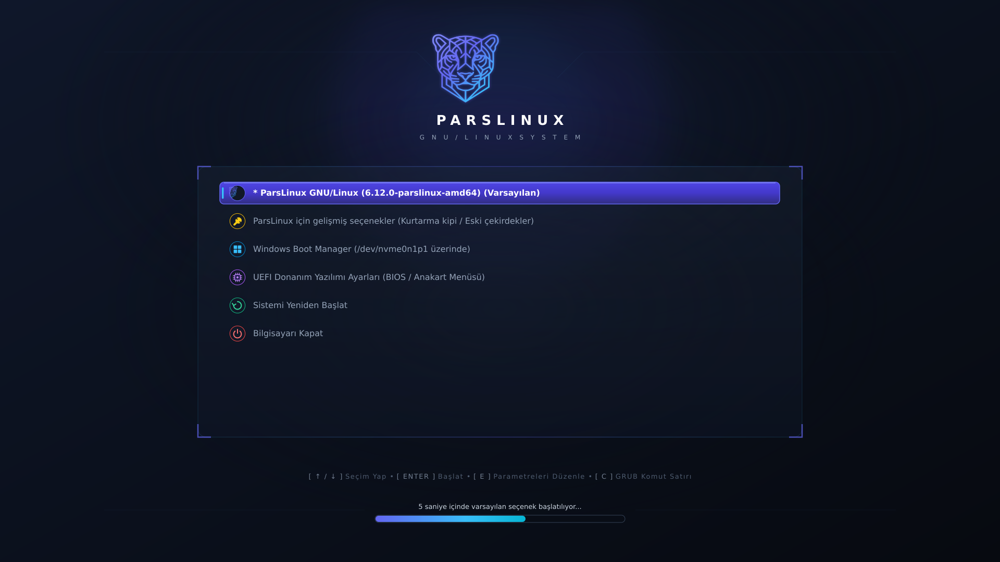

# 🐆 ParsLinux GRUB2 Teması (`parslinux-grub-theme`)

Modern, şık ve yüksek çözünürlüklü ekranlar (Full HD, 2K, 4K) için özel olarak tasarlanmış resmi **ParsLinux GRUB2 Önyükleme Teması**.

Bilgisayar açılırken klasik siyah ve metin tabanlı GRUB ekranı yerine, ParsLinux Anadolu Parsı amblemi, neon siber hatlar ve zarif yarı saydam (glassmorphic) menü paneli ile premium bir karşılama sunar.

---

## ✨ Özellikler

- 🌟 **Yüksek Çözünürlüklü Görsel Deneyim**: 1920x1080 yerel çözünürlük; 16:9, 16:10 ve ultra geniş monitörlerde otomatik ölçeklenme.
- 🐆 **Resmi ParsLinux Markalama**: İnce işlenmiş Pars geometrik amblemi, neon eflatun-indigo-camgöbeği ışıma ve tipografi.
- 🖼️ **Genişletilmiş İşletim Sistemi İkon Paketi**:
  - `ParsLinux`, `GNU/Linux`, `Debian`, `Ubuntu`, `Arch Linux`, `Fedora`
  - `Windows 10/11`, `UEFI Donanım Ayarları`, `Yeniden Başlat`, `Kapat`, `Kurtarma Modu`, `Bellek Testi`
- 🎯 **Modern Seçim ve İlerleme Çubuğu**:
  - Yuvarlatılmış neon göstergeli seçim kapsülü (`select_*.png`)
  - Zaman aşımı geri sayımı için ortalanmış ince ilerleme çubuğu (`progress_bar_*.png`)
- 🖥️ **Zarif Uçbirim Kutusu**: GRUB komut satırı (`c`) ve çekirdek parametresi düzenleme (`e`) modları için özel koyu çerçeve.
- 📦 **Evrensel Kurulum Desteği**: Debian/Ubuntu paketlemesi (`.deb`) ve tüm Linux dağıtımları için tek tıkla kurulum betiği (`install.sh`).

---

## 📸 Ekran Önizlemesi



```text
+--------------------------------------------------------------------------+
|                                                                          |
|                                [ 🐆 ]                                    |
|                              PARSLINUX                                   |
|                      G N U / L I N U X   S Y S T E M                     |
|                                                                          |
|       +----------------------------------------------------------+       |
|       |  [🐆]  ParsLinux GNU/Linux (Varsayılan)                   |       |
|       |  [⚙️]  ParsLinux için gelişmiş seçenekler                 |       |
|       |  [🪟]  Windows Boot Manager                               |       |
|       |  [🔧]  UEFI Donanım Yazılımı Ayarları                    |       |
|       |  [🔄]  Yeniden Başlat                                     |       |
|       |  [⏻]   Sistemi Kapat                                      |       |
|       +----------------------------------------------------------+       |
|                                                                          |
|       [ ↑ / ↓ ] Seçim Yap  •  [ ENTER ] Başlat  •  [ E ] Düzenle         |
|                       [========== 5s ==========]                         |
+--------------------------------------------------------------------------+
```

---

## 🚀 Kurulum

### Yöntem 1: Hızlı Kurulum Betiği (Tüm Dağıtımlar)

Depoyu klonlayıp kurulum betiğini root haklarıyla çalıştırın:

```bash
git clone https://github.com/parslinux/parslinux-grub-theme.git
cd parslinux-grub-theme
sudo ./install.sh
```

Betik otomatik olarak:
1. Tema dosyalarını `/boot/grub/themes/parslinux` ve `/usr/share/grub/themes/parslinux` konumlarına kopyalar.
2. `/etc/default/grub` dosyasını yedekler ve `GRUB_THEME` ile `GRUB_GFXMODE` değerlerini ayarlar.
3. `grub-mkconfig` / `update-grub` komutunu çalıştırarak temayı etkinleştirir.

---

### Yöntem 2: Debian / ParsLinux Paketi ile Kurulum

```bash
# Paket derleme (Debian tabanlı sistemlerde)
dpkg-buildpackage -us -uc -b

# Kurulum
sudo dpkg -i ../parslinux-grub-theme_1.0.0_all.deb
```

---

### Yöntem 3: Elle Yapılandırma

1. Tema klasörünü kopyalayın:
   ```bash
   sudo mkdir -p /boot/grub/themes
   sudo cp -r parslinux /boot/grub/themes/
   ```

2. `/etc/default/grub` dosyasını düzenleyin:
   ```ini
   GRUB_THEME="/boot/grub/themes/parslinux/theme.txt"
   GRUB_GFXMODE="1920x1080,auto"
   ```

3. GRUB yapılandırmasını güncelleyin:
   ```bash
   sudo update-grub
   # veya Arch / Fedora üzerinde:
   sudo grub-mkconfig -o /boot/grub/grub.cfg
   ```

---

## 🗑️ Temayı Kaldırma

Temayı kaldırmak ve varsayılan GRUB görünümüne dönmek için:

```bash
sudo ./uninstall.sh
```

---

## 📁 Dizin Yapısı

```
parslinux-grub-theme/
├── parslinux/
│   ├── background.png           # 1920x1080 ışıltılı ParsLinux arka planı
│   ├── theme.txt                # GRUB gfxmenu yapılandırma kuralları
│   ├── select_*.png             # Seçili menü öğesi kapsül parçaları
│   ├── progress_bar_*.png       # Geri sayım çubuğu görsel stilleri
│   ├── terminal_box_*.png       # GRUB konsol/düzenleme arka planı
│   ├── *.pf2                    # GRUB bitmap yazı tipi dosyaları
│   └── icons/                   # İşletim sistemi ve fonksiyon ikonları
│       ├── parslinux.png
│       ├── pars.png
│       ├── linux.png
│       ├── gnu-linux.png
│       ├── debian.png
│       ├── arch.png
│       ├── ubuntu.png
│       ├── fedora.png
│       ├── windows.png
│       ├── uefi.png
│       ├── reboot.png
│       └── shutdown.png
├── debian/                      # Debian paket yapılandırması
├── install.sh                   # Otomatik kurulum aracı
├── uninstall.sh                 # Temizleme aracı
├── Makefile                     # Standart derleme/yükleme kuralları
└── README.md
```

---

## 📄 Lisans

Bu proje GNU Genel Kamu Lisansı sürüm 3 (GPL-3.0+) altında lisanslanmıştır.  
Kaynak: `pardus-bilge-grub-theme` projesinden ParsLinux için forku üretilmiştir.
